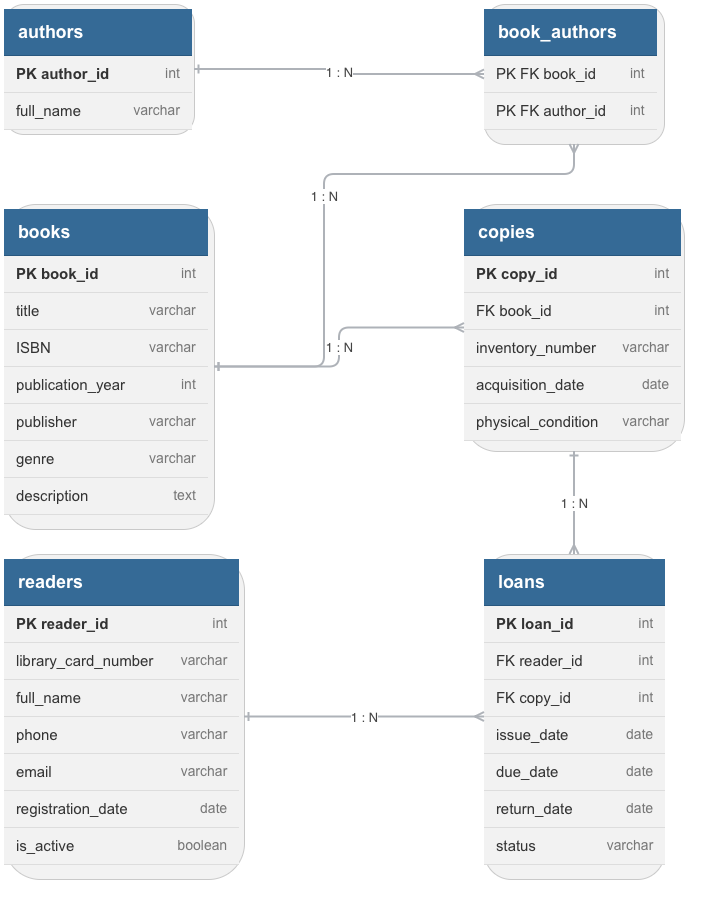

# Анализ и моделирование данных предметной области

Вариант 5. Библиотечная система

## 1. Описание предметной области

Предметная область: библиотечная система (учёт библиотечного фонда).

Назначение системы: хранение и обработка информации о библиотечном фонде, библиографическом каталоге, читателях и операциях выдачи и возврата книг. Система позволяет библиотекарю контролировать движение каждого физического экземпляра, а также определять, какие книги доступны для получения читателями.

### Основные пользователи системы

- Библиотекари — ведут каталог, регистрируют читателей, оформляют выдачу и возврат экземпляров, контролируют их состояние.

- Читатели — ищут книги в каталоге, получают экземпляры во временное пользование и возвращают их.

- Администратор библиотеки — отвечает за настройку и контроль справочной информации и учётных записей сотрудников.

### Основные процессы

- ведение и обновление каталога книг и сведений об авторах;

- регистрация читателей и оформление читательских билетов;

- учёт физических экземпляров каждой книги и их инвентарных номеров;

- оформление выдачи экземпляра читателю с указанием даты выдачи и срока возврата;

- регистрация возврата и обновление сведений о состоянии экземпляра;

- контроль доступности экземпляров и просмотр истории выдач.

### Основные задачи информационной системы

- хранение сведений о книгах, авторах и экземплярах библиотечного фонда;

- хранение данных о читателях;

- учёт операций выдачи и возврата;

- определение количества доступных экземпляров каждой книги;

- получение истории пользования экземплярами и истории выдач читателя.

## 2. Объекты данных

Для описания основных процессов библиотечной системы выделены следующие объекты данных. Физический экземпляр рассматривается отдельно от библиографической записи книги: одна книга может иметь несколько экземпляров с разными инвентарными номерами.

### Читатель (Reader)

Назначение: Человек, зарегистрированный в библиотеке и получающий экземпляры книг во временное пользование.

Необходимо хранить: Идентификатор читателя, номер читательского билета, ФИО, телефон, электронная почта, дата регистрации, признак активности.

### Книга (Book)

Назначение: Библиографическая запись, описывающая произведение или издание в каталоге библиотеки.

Необходимо хранить: Идентификатор книги, название, ISBN, год издания, издательство, жанр, описание.

### Экземпляр книги (Copy)

Назначение: Отдельный физический экземпляр издания, который хранится в библиотечном фонде и может быть выдан читателю.

Необходимо хранить: Идентификатор экземпляра, идентификатор книги, инвентарный номер, дата поступления, физическое состояние.

### Автор (Author)

Назначение: Лицо, указанное в каталоге как автор книги.

Необходимо хранить: Идентификатор автора, ФИО автора.

### Выдача (Loan)

Назначение: Запись об операции предоставления конкретного экземпляра конкретному читателю и его последующем возврате.

Необходимо хранить: Идентификатор выдачи, идентификаторы читателя и экземпляра, дата выдачи, срок возврата, фактическая дата возврата, статус.

### Книга_Автор (BookAuthor)

Назначение: Связующий объект для реализации связи многие ко многим между книгами и авторами.

Необходимо хранить: Идентификатор книги и идентификатор автора. Оба атрибута образуют составной первичный ключ.

## 3. Атрибуты объектов

Для атрибутов указаны обобщённые типы данных, как требуется в задании. Обозначения PK и FK используются для пояснения предполагаемых ключей и связей концептуальной модели; конкретные типы и ограничения СУБД на данном этапе не задаются.

### Объект: Читатель (Reader)

| Атрибут | Тип данных | Описание |
| --- | --- | --- |
| reader_id (PK) | Число | Уникальный идентификатор читателя. |
| library_card_number | Строка | Уникальный номер читательского билета. |
| full_name | Строка | Фамилия, имя и отчество читателя. |
| phone | Строка | Контактный номер телефона. |
| email | Строка | Адрес электронной почты. |
| registration_date | Дата | Дата регистрации читателя в библиотеке. |
| is_active | Логическое значение | Показывает, действует ли регистрация читателя. |

### Объект: Книга (Book)

| Атрибут | Тип данных | Описание |
| --- | --- | --- |
| book_id (PK) | Число | Уникальный идентификатор библиографической записи. |
| title | Строка | Название книги. |
| ISBN | Строка | Международный стандартный номер книги; хранится как строка, поскольку может содержать дефисы и ведущие нули. |
| publication_year | Число | Год издания. |
| publisher | Строка | Название издательства. |
| genre | Справочное значение | Жанр или тематическая категория из установленного перечня. |
| description | Строка | Краткое описание книги. |

### Объект: Экземпляр книги (Copy)

| Атрибут | Тип данных | Описание |
| --- | --- | --- |
| copy_id (PK) | Число | Уникальный идентификатор физического экземпляра. |
| book_id (FK) | Число | Ссылка на библиографическую запись книги. |
| inventory_number | Строка | Уникальный инвентарный номер экземпляра. |
| acquisition_date | Дата | Дата поступления экземпляра в библиотеку. |
| physical_condition | Справочное значение | Текущее состояние экземпляра. |

### Объект: Автор (Author)

| Атрибут | Тип данных | Описание |
| --- | --- | --- |
| author_id (PK) | Число | Уникальный идентификатор автора. |
| full_name | Строка | Фамилия, имя и отчество или общепринятая форма имени автора. |

### Объект: Выдача (Loan)

| Атрибут | Тип данных | Описание |
| --- | --- | --- |
| loan_id (PK) | Число | Уникальный идентификатор операции выдачи. |
| reader_id (FK) | Число | Ссылка на читателя, которому выдан экземпляр. |
| copy_id (FK) | Число | Ссылка на выданный физический экземпляр. |
| issue_date | Дата | Дата выдачи экземпляра. |
| due_date | Дата | Установленная дата возврата. |
| return_date | Дата | Фактическая дата возврата; до возврата значение не заполнено. |
| status | Справочное значение | Состояние операции, например: выдана или возвращена. |

### Объект: Книга_Автор (BookAuthor)

| Атрибут | Тип данных | Описание |
| --- | --- | --- |
| book_id (PK, FK) | Число | Ссылка на книгу; часть составного первичного ключа. |
| author_id (PK, FK) | Число | Ссылка на автора; часть составного первичного ключа. |

## 4. Классификация данных

Атрибуты библиотечной системы распределены по категориям в зависимости от характера хранимой информации.

| Категория данных | Атрибуты / примеры | Назначение |
| --- | --- | --- |
| Текстовые | Читатель: library_card_number, full_name, phone, email; Книга: title, ISBN, publisher, description; Автор: full_name; Экземпляр: inventory_number. | Хранят имена, контактные данные, обозначения и описания. ISBN и инвентарный номер являются строками, а не числами. |
| Числовые | Идентификаторы reader_id, book_id, copy_id, author_id, loan_id; publication_year. | Используются для идентификации объектов и хранения года издания. |
| Даты | registration_date, acquisition_date, issue_date, due_date, return_date. | Фиксируют регистрацию читателя, поступление экземпляра, выдачу и возврат книги. |
| Логические | Reader.is_active. | Принимает два значения и показывает, активен ли читатель в библиотечной системе. |
| Справочные | Book.genre; Copy.physical_condition; Loan.status. | Значения выбираются из ограниченного перечня. Это помогает единообразно классифицировать жанры, состояние экземпляров и состояние выдач. |
| Вычисляемые | Количество доступных экземпляров книги; признак просрочки возврата. | Количество доступных экземпляров определяется по экземплярам, которые находятся в допустимом состоянии и не имеют активной выдачи. Просрочка определяется сравнением due_date с текущей датой при отсутствии return_date. |

В модели не требуется отдельно хранить общее количество доступных экземпляров книги: это значение можно получить на основе списка экземпляров и незавершённых выдач. Такой подход уменьшает риск расхождения между фактическим состоянием фонда и сохранённым числом доступных книг.

## 5. Связи между объектами

| Объект 1 | Объект 2 | Тип связи | Описание |
| --- | --- | --- | --- |
| Книга (Book) | Экземпляр книги (Copy) | 1:N | Одна библиографическая запись может иметь несколько физических экземпляров. Каждый экземпляр относится только к одной книге. |
| Читатель (Reader) | Выдача (Loan) | 1:N | Один читатель может иметь несколько записей о выдачах за всё время. Каждая запись о выдаче относится к одному читателю. |
| Экземпляр книги (Copy) | Выдача (Loan) | 1:N | Один экземпляр может участвовать во многих выдачах в разные периоды. Каждая запись о выдаче относится к одному конкретному экземпляру. Одновременно у экземпляра может быть не более одной активной выдачи. |
| Книга (Book) | Автор (Author) | M:N | У одной книги может быть несколько авторов, а один автор может быть связан с несколькими книгами. Связь реализуется через промежуточный объект Книга_Автор (BookAuthor). |
| Книга (Book) | Книга_Автор (BookAuthor) | 1:N | Одна книга может иметь несколько строк-связей с авторами. Каждая строка BookAuthor относится к одной книге. |
| Автор (Author) | Книга_Автор (BookAuthor) | 1:N | Один автор может встречаться в нескольких строках BookAuthor. Каждая строка BookAuthor относится к одному автору. |

## 6. Концептуальная модель данных

На концептуальной модели представлены основные объекты библиотечной системы, их ключевые атрибуты и кардинальности связей. Таблица BookAuthor используется для реализации связи M:N между книгами и авторами. Объект Loan связывает читателя с конкретным физическим экземпляром и хранит даты выдачи и возврата.

## 7. Оценка качества исходных данных

1. Достаточно ли объектов выделено?

Для учёта каталога, регистрации читателей, выдачи и возврата книг, а также доступности экземпляров выделенных объектов достаточно. В модель включены читатели, книги, экземпляры, авторы, выдачи и связующий объект Книга_Автор.

2. Отсутствуют ли важные сущности?

Для указанного в задании объёма критически важных пропусков нет. При расширении системы можно добавить библиотекарей, филиалы, бронирования, штрафы и платежи. Эти сущности не включены, поскольку основные процессы варианта 5 можно описать без них.

3. Все ли необходимые атрибуты определены?

Определены атрибуты, необходимые для идентификации читателей, библиографических записей, физических экземпляров, авторов и операций выдачи. Для реальной эксплуатации могут понадобиться дополнительные сведения: адрес читателя, ограничения по сроку и количеству выдач, место хранения экземпляра и история изменения его состояния.

4. Имеются ли дублирующиеся данные?

Явного дублирования нет. Библиографические сведения хранятся в объекте Book, данные о физических копиях — в Copy, сведения о читателях — в Reader, а каждая операция движения экземпляра — в Loan. Данные об авторах вынесены отдельно и связываются с книгами через BookAuthor.

5. Достаточно ли информации для дальнейшего проектирования информационной системы?

Да. Определены основные объекты, атрибуты, категории данных и связи. Модель может служить основой для дальнейшего проектирования базы данных. Перед реализацией необходимо уточнить правила выдачи: максимальное число экземпляров на читателя, стандартный срок пользования, возможность продления и правила обработки просрочки.

## Вывод

В ходе лабораторной работы была проанализирована предметная область библиотечной системы. Выделены основные объекты данных: читатели, книги, физические экземпляры, авторы и операции выдачи. Для объектов определены атрибуты, предполагаемые типы данных и назначение каждого атрибута.

Установлены связи 1:N между книгой и её экземплярами, читателем и выдачами, экземпляром и историей его выдач. Связь M:N между книгами и авторами реализована через BookAuthor. Модель описывает каталог, регистрацию читателей, движение экземпляров и доступность фонда и может служить основой дальнейшего проектирования библиотечной системы.
